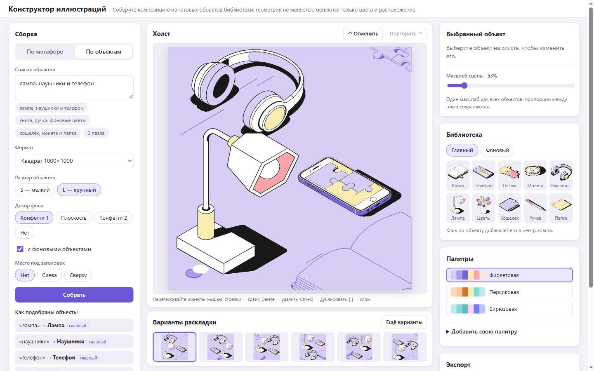
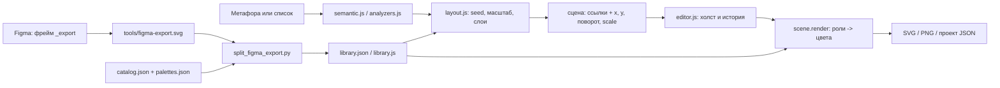
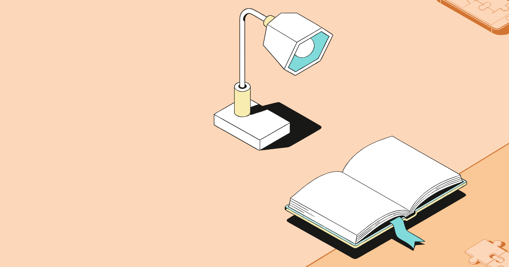
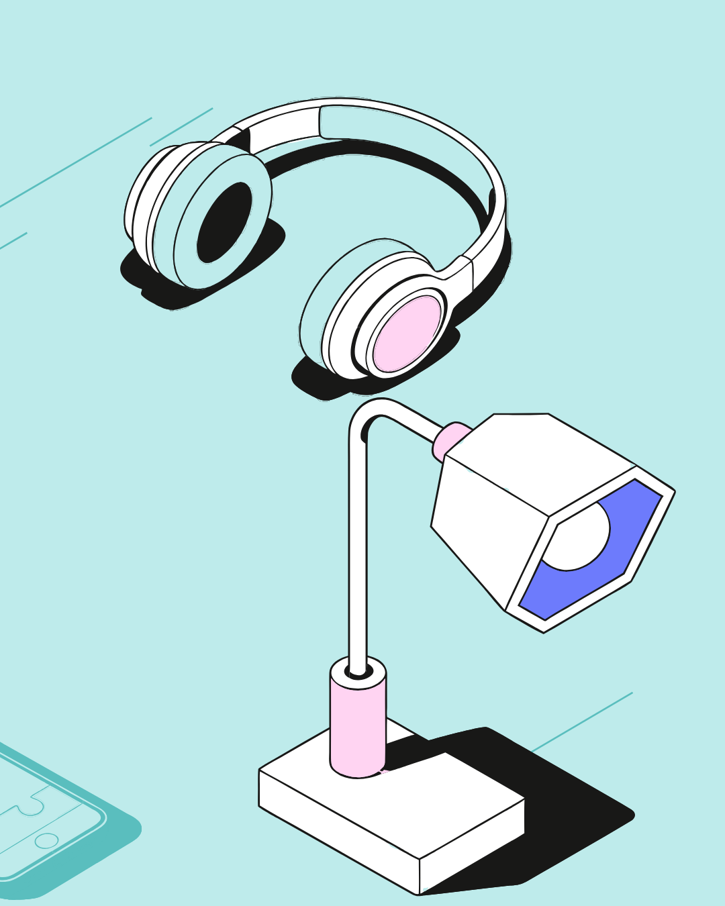

# Конструктор иллюстраций



Веб-сервис, который собирает композиции из готовых векторных объектов (тестовое задание). Объекты не генерируются и не меняются: копируется их геометрия, меняются только цвета ролей, положение, поворот и общий масштаб сцены. Результат — SVG без растра.

- Сервис: https://more2manov.github.io/desigh_test/
- Демо: ссылка будет добавлена (сценарий записи — [docs/DEMO.md](docs/DEMO.md))
- Репозиторий: https://github.com/more2manov/desigh_test
- Запуск локально: двойной клик по `index.html`. Работает через `file://`, без сервера, сборки и npm-зависимостей. Интерфейс на русском.

## Возможности

**Два сценария сборки** (вкладки панели «Сборка»):
1. «По метафоре» — вводите метафору или заголовок («финансовая грамотность», «идея для стартапа»), сервис подбирает объекты и показывает, какое слово привело к какому объекту.
2. «По объектам» — вводите названия («лампа, наушники и телефон», «книга, ручка, фоновые цветы»). Слова «фоновый», «фон», «монохромный» делают объект фоновым; «3 пазла» даёт три объекта.

**Холст:** выделение, перетаскивание, поворот за ручку над рамкой (Shift — шаг 15°), добавление из библиотеки как главного или фонового, дублирование, удаление, порядок слоёв (выше/ниже/наверх/вниз), смена главный↔фоновый, «Сменить цвета» (циклический сдвиг цветов объекта внутри схемы), отмена/повтор (до 100 шагов).
Клавиши (не работают при фокусе в поле ввода, срабатывают и в русской раскладке): стрелки — 1 px (Shift — 10 px), Delete/Backspace, Ctrl+D, Ctrl+Z, Ctrl+Y / Ctrl+Shift+Z, `[` и `]` — слои.

**Параметры сцены:**
- детализация (размер иллюстрации) S / L: упрощённый или подробный набор объектов подменяется автоматически, визуальный размер и «Масштаб сцены» сохраняются;
- форматы холста: квадрат 1000×1000, обложка 1200×630, пост 1080×1350, баннер 1920×1080, сторис 1080×1920;
- общий масштаб сцены — один слайдер на все объекты (20–300%);
- декор фона («Конфетти» / «Плоскость» / «Нет»; перекрашивается под выбранную схему) и «место под заголовок» (слева / сверху) — зона, в которую раскладка не ставит объекты;
- 6 вариантов раскладки под холстом, кнопка «Ещё варианты» собирает новые.

**Цветовые схемы:** три схемы из макета (выбор справа, в блоке «Палитры»). Своя палитра: 6 или 8 hex-цветов (сначала цвета фона, затем цвета объектов) или JSON; объекты перекрашиваются автоматически. Свои палитры хранятся в `localStorage` (`ic.customSchemes`).

**Экспорт:** скачать SVG, скачать PNG, копировать SVG; проект — «Сохранить проект» / «Открыть проект» (JSON `{app, version:1, scene, customSchemes}`). Если страница открыта как артефакт claude.ai, скачивание идёт через `claude.use('downloads')`, иначе — обычной ссылкой `<a download>`.

**Анализ метафоры** (переключатель «Словарь / LLM»):
- Словарь — офлайн, по основам слов и тегам из `data/catalog.json`.
- LLM: на claude.ai используется встроенный Claude (`claude.use('sample')`); в остальных местах нужен свой ключ Anthropic API — запрос идёт напрямую из браузера, модель по умолчанию `claude-haiku-5-5` (можно указать свою).
- Ключ по умолчанию нигде не сохраняется (только если отметить «запомнить» — тогда в `localStorage`), в SVG и в файл проекта не попадает.
- Ответ LLM принимается только с id из библиотеки. При ошибке, неверном ответе или таймауте (10 с) сервис откатывается на словарь и сообщает причину.

## Архитектура

### Хранение
Библиотека — `data/library.json`; та же в виде скрипта `data/library.js` (`window.IC_LIBRARY = ...`), чтобы страница открывалась по `file://` без сервера. Состав: 10 объектов (книга, телефон, пазл, монета, наушники, лампа, цветы, кошелёк, ручка, папка) × размеры L/S × вид main/bg, 3 декора фона и палитры. Базовый холст: L — 1000, S — 500. У каждого вида хранятся `w`, `h`, список использованных ролей и SVG-разметка.

Цвета в разметке записаны **ролями** (`fill="@bg1"`, `@obj2` …), а не hex. Роли (`data/palettes.json`, `src/palette.js`): `bg1 bg2 bg3 ink` | `obj1 obj2 obj3 paper` — цвета фона, тёмный контур, цвета объектов, белый. Те же объекты лежат отдельными файлами в `library/<L|S>/<main|bg|decor>/<id>.svg` (в исходных цветах). Названия, алиасы и смысловые теги — в `data/catalog.json`.

### Извлечение
1. В копии макета Figma собран служебный фрейм `_export`: каждый объект — группа с меткой `obj__<id>__<L|S>__<main|bg>` (декоры — `obj__bgframe-<id>__<L|S>__fon`).
2. Фрейм экспортирован в `tools/figma-export.svg` (с `svgIdAttribute`), координаты групп — в `tools/figma-export-layout.json`.
3. `tools/split_figma_export.py` ищет группы по префиксу `obj__`, сдвигает каждую в (0,0), убирает служебные `id`/`clip-path`, заменяет цвета исходной (фиолетовой) схемы ролями палитры — цвет вне палитры останавливает скрипт с ошибкой — и пишет `data/library.json`, `data/library.js` и `library/**.svg`. Пути не изменяются.

### Переиспользование
Сцена — это ссылки, а не копии: `{format, size, schemeId, decor, scale, titleZone, items:[{uid, objectId, kind, x, y, rotation, colorShift}]}` (`src/scene.js`). Рендер для каждого объекта берёт разметку из библиотеки как есть, подставляет цвета ролей выбранной схемы и оборачивает в `<g id>` с одним `transform` (позиция, поворот, общий масштаб). Перекраска = подстановка цветов ролей в `@role`; геометрия не затрагивается.

### Автокомпоновка (`src/layout.js`)
- Один общий масштаб считается по заполнению доступной области; с зоной заголовка заполнение выше (0,62 / 0,74 / 0,84 для 1 / 2 / 3+ главных).
- Раскладка детерминирована по `seed` (генератор mulberry32): ~500 случайных раскладок + доводка hill climbing.
- Оценка: перекрытия (по bbox, ужатым на 12%, допускается ~15%), видимость главного объекта ≥95%, остальных главных ≥75%, баланс и разнесённость; выход за край холста ограничен.
- Слои: чем ниже нижний край объекта, тем выше слой; фоновые объекты — под главными, ближе к краям и углам, видны на 35–65% площади.
- Зона заголовка (`left` — x < 0,42·W, `top` — y < 0,35·H) исключается из области размещения.
- `variants(lib, opts, 6)` — 6 раскладок с разными seed.

### Подбор по метафоре
`src/semantic.js` — словарь: слова приводятся к основам (простой стемминг окончаний, стоп-слова) и сравниваются с алиасами и тегами каталога. `src/analyzers.js` — надстройка с LLM, возвращающая результат той же формы `{source, main, bg, reason, matches, unknown}`; при любой проблеме откатывается на словарь.

### Модули

| Файл | Назначение |
|---|---|
| `data/library.json`, `data/library.js` | библиотека объектов, декоров и палитр |
| `data/catalog.json`, `data/palettes.json` | названия, алиасы, теги; цветовые схемы и роли |
| `src/palette.js` | перекраска ролей, сдвиг цветов объекта, разбор своей палитры |
| `src/scene.js` | модель сцены, форматы, рендер в SVG, смена S↔L |
| `src/semantic.js` | офлайн-подбор по метафоре, разбор списка объектов |
| `src/analyzers.js` | анализ метафоры: словарь или LLM, откат на словарь |
| `src/layout.js` | автокомпоновка, метрики, варианты раскладки |
| `src/editor.js` | холст: выделение, перетаскивание, поворот, клавиши, история, экспорт SVG/PNG |
| `src/app.js` | интерфейс: сборка, варианты, свойства, библиотека, палитры, проект |
| `tools/split_figma_export.py` | нарезка экспорта Figma в библиотеку |
| `tools/render-examples.js` | пересборка примеров в `examples/` |

Контракт `editor.js` ↔ `app.js` — `docs/INTERFACE.md`. Порядок скриптов в `index.html`: `data/library.js`, `palette`, `scene`, `semantic`, `analyzers`, `layout`, `editor`, `app`; все модули кладут себя в общий `window.IC`.



## Как соблюдены правила макета

1. **Объекты не меняются.** Библиотека не редактируется на лету; `scene.renderItem` (`src/scene.js`) вставляет разметку вида из библиотеки и меняет только цвета ролей (`IC.palette.paint`). Скрипт нарезки не правит пути. Тест `tests/run-tests.js` сверяет пути (`d`) экспорта с библиотекой.
2. **Один общий масштаб.** В сцене единственное поле `scale`, у элемента его нет; `itemTransform` и `itemSize` в `src/scene.js` берут `scene.scale`. `layout.compose` вычисляет один `scale` для всех объектов; в `editor.js` масштаба отдельного объекта нет, меняется только `scene.scale` через `update` (слайдер). Тест «у всех объектов один масштаб».
3. **Цвета объектов не в фоне.** Подложка (`<rect id="background">`) — всегда `bg1` схемы. Декор в библиотеке использует только роли `bg2`, `bg3`, `paper`, фоновые объекты (вид `bg`) — только `bg1`, `bg3` (проверено по `library.json`). `colorShift` сдвигает только `obj1..obj3` и в фоне не участвует. Обратное допустимо по заданию: главные объекты используют и цвета фона.
4. **SVG без растра, каждый объект в своей группе.** `scene.render` собирает только `<g>`, `<path>`, `<rect>`, `<clipPath>`; в разметке библиотеки нет `<image>`. Каждый объект — `<g id="<объект>[-bg]-<номер>">` (например `lamp-1`) внутри `<g id="objects">`; в экспорте служебные `data-*` убираются. Тест «в SVG нет `<image>`, у каждого объекта свой `<g id>`».

## Как добавить новый объект в библиотеку

1. В Figma добавьте в служебный фрейм `_export` по группе на каждый вариант: `obj__<id>__L__main`, `obj__<id>__L__bg`, `obj__<id>__S__main`, `obj__<id>__S__bg`. Цвета — только из палитры `data/palettes.json` (исходная схема — `violet`), иначе скрипт остановится с ошибкой.
2. Экспортируйте фрейм в SVG с включённым `svgIdAttribute` в `tools/figma-export.svg` и обновите `tools/figma-export-layout.json` (имя, `x`, `y`, `w`, `h` каждой группы).
3. Опишите объект в `data/catalog.json`, в массиве `objects`: `id`, `name`, `aliases`, `tags`.
4. Запустите нарезку (нужен Python 3; в Windows — `py`):
   ```
   py tools/split_figma_export.py      # или: python3 tools/split_figma_export.py
   ```
   Обновятся `data/library.json`, `data/library.js` и `library/**.svg`.
5. Проверьте: `node tests/run-tests.js`.

## AI-инструменты

- **Claude (claude.ai) с коннектором Figma** — разбор задания, выгрузка и нарезка библиотеки, проектирование.
- **Claude Code в VS Code** — разработка: координатор Claude Opus 5.5 и субагенты Claude Sonnet 5.5 (код, рефакторинг, ревью) и Claude Haiku 5.5 (поиск, тесты, браузерные проверки).
- **Playwright MCP** — проверка интерфейса в браузере.
- История промптов — `docs/PROMPT_LOG.md`.

## Примеры

Пересборка: `node tools/render-examples.js` (создаёт `examples/*.svg`; PNG — только если найден Chrome по пути, прописанному в скрипте).

| «финансовая грамотность» | «идея для стартапа» | «лампа наушники фоновый телефон» |
|---|---|---|
|  |  |  |
| сценарий 1, квадрат, фиолетовая схема | сценарий 1, обложка, персиковая схема, место под заголовок слева | сценарий 2 (список без запятых, телефон — фон), пост, бирюзовая схема |

SVG-версии лежат рядом (`examples/*.svg`).

## Тесты

Node без зависимостей:

```
node tests/run-tests.js        # раскладка и сцена
node tests/editor-smoke.js     # редактор на заглушке DOM
node tests/analyzers-tests.js  # анализ метафоры
```

- `run-tests.js` — один масштаб, объекты из библиотеки, видимость главных и фоновых, слои, зона заголовка, детерминизм по seed, скорость раскладки, подбор для трёх проверочных запросов и набор метафор, экспорт без `<image>` с отдельным `<g id>` и совпадением путей с библиотекой.
- `editor-smoke.js` — добавление, дубли, слои, смена типа и цветов, поворот, undo/redo и лимит истории, клавиши, игнор ввода в полях, чистый экспорт SVG.
- `analyzers-tests.js` — словарный анализ, `claude.use`, запрос по API (заголовки, модель по умолчанию, ключ не попадает в результат), откат при сети, HTTP 401, таймауте, неверных id и мусорном ответе.

## Ограничения и что можно улучшить

- Раскладка считает по прямоугольникам (bbox) вместо силуэтов, поэтому пустоты объекта могут выглядеть крупными.
- В форматах banner и top с зоной заголовка занятость области около 0,61 — она ограничена высотой области.
- «Ещё варианты» и 6 вариантов раскладки не меняют `colorShift` (у всех 0), различаются только расположением.
- При 1440×900 полоса вариантов ниже первого экрана — нужно прокрутить.
- Скачивание через `claude.use('downloads')` проверено только по коду (работает лишь на claude.ai).
- В библиотеке только 10 объектов; словарь ограничен тегами каталога — незнакомые слова не распознаются (для этого есть режим LLM).
- Ключ API в браузере доступен владельцу этого браузера, поэтому по умолчанию он не запоминается.
- PNG-примеры рендерятся через установленный Chrome (путь указан в `tools/render-examples.js`).
